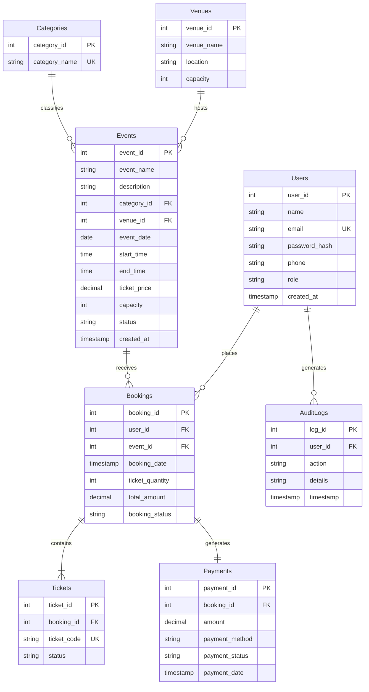

# EventSphere – Event Management System (v2)
### Complete DBMS Mini-Project Documentation & Viva Guide

---

## 1. Project Overview

**EventSphere** is an enterprise-pattern, beginner-friendly Event Management System built using **pure Java, MySQL, and JDBC**. It runs directly inside the **Windows Command Prompt (CMD)** without any bloated frameworks (No Spring Boot, No React, No HTML/CSS, No APIs).

### Key Features
- **Role-Based Access Control**:
  - **Admin**: Dashboard aggregates, event CRUD, venue conflict detection, capacity checks, publishing, rescheduling, cancellation, venue/category management, customer records, booking management, payment records, revenue reports, and registration stats.
  - **Customer**: Dynamic event discovery, keyword search, category/date filtering, multi-seat ticket booking, live available seat calculations, personal booking history, unique ticket code view, self-service cancellation, and payment receipts.
- **Security**: SHA-256 password hashing via Java `MessageDigest` matching MySQL `SHA2()` standard. Admin accounts cannot be self-registered.
- **Data Integrity**: MySQL transactions (`START TRANSACTION`, `COMMIT`, `ROLLBACK`), Stored Procedures, Triggers, Foreign Keys with cascading actions, and Unique constraints.
- **Dynamic SQL**: No hardcoded event names, counts, or revenues in Java; all data is fetched live using parameterized `PreparedStatement` queries.

---

## 2. Project File Structure

All project files are located in `EventSphere/`:

| File | Purpose |
|------|---------|
| [`database.sql`](file:///c:/Users/raghu/Desktop/sql/EventSphere/database.sql) | DDL script: creates `eventsphere` database and 8 relational tables with constraints |
| [`procedures.sql`](file:///c:/Users/raghu/Desktop/sql/EventSphere/procedures.sql) | Stored procedure `BookEvent` with multi-ticket loop, capacity check, and atomic rollback |
| [`triggers.sql`](file:///c:/Users/raghu/Desktop/sql/EventSphere/triggers.sql) | Triggers for booking cancellation (auto-cancel tickets + refund payment) and race-condition prevention |
| [`indexes.sql`](file:///c:/Users/raghu/Desktop/sql/EventSphere/indexes.sql) | 10 performance indexes on frequently searched and joined columns |
| [`sample_data.sql`](file:///c:/Users/raghu/Desktop/sql/EventSphere/sample_data.sql) | Pre-seeded sample data: 1 admin, 5 customers, 5 venues, 5 categories, 6 events, bookings, tickets, payments, logs |
| [`DBConnection.java`](file:///c:/Users/raghu/Desktop/sql/EventSphere/DBConnection.java) | Database connection singleton using JDBC `DriverManager` and `com.mysql.cj.jdbc.Driver` |
| [`User.java`](file:///c:/Users/raghu/Desktop/sql/EventSphere/User.java) | Session model holding user ID, name, email, phone, and role (`admin` / `customer`) |
| [`AuthService.java`](file:///c:/Users/raghu/Desktop/sql/EventSphere/AuthService.java) | SHA-256 password hashing, user registration (customer-only), login verification, and audit logging |
| [`Event.java`](file:///c:/Users/raghu/Desktop/sql/EventSphere/Event.java) | Event model holding full event details including live available seats |
| [`EventDAO.java`](file:///c:/Users/raghu/Desktop/sql/EventSphere/EventDAO.java) | Data Access Object for Event CRUD, venue conflict checking, category/date filters, and venue/category lookup |
| [`BookingDAO.java`](file:///c:/Users/raghu/Desktop/sql/EventSphere/BookingDAO.java) | DAO for executing `CALL BookEvent(?,?,?)`, viewing customer bookings, tickets, payments, and admin aggregate reports |
| [`AdminPanel.java`](file:///c:/Users/raghu/Desktop/sql/EventSphere/AdminPanel.java) | 17-option Admin menu interface with live dashboard and management operations |
| [`CustomerPanel.java`](file:///c:/Users/raghu/Desktop/sql/EventSphere/CustomerPanel.java) | 11-option Customer menu interface for event browsing, searching, booking, and ticket management |
| [`Main.java`](file:///c:/Users/raghu/Desktop/sql/EventSphere/Main.java) | Application entry point: connection verification, authentication router, and session lifecycle |
| [`run.bat`](file:///c:/Users/raghu/Desktop/sql/EventSphere/run.bat) | Windows batch script to detect MySQL JDBC JAR, compile all 9 Java files, and run the program |

---

## 3. Database Schema (8 Tables)



---

## 4. Database Normalization (1NF, 2NF, 3NF)

### First Normal Form (1NF)
- **Rule**: Every column must contain atomic (indivisible) values. No repeating groups or comma-separated lists. Every table must have a primary key.
- **Application in EventSphere**:
  - In a poorly designed system, multiple tickets might be stored as a comma-separated string `TKT-1, TKT-2` inside a booking row.
  - EventSphere satisfies 1NF by breaking individual tickets into their own `Tickets` table, where each row holds exactly one atomic `ticket_code`.

### Second Normal Form (2NF)
- **Rule**: Must be in 1NF, and all non-key attributes must be fully functionally dependent on the entire primary key (no partial dependency on a composite key).
- **Application in EventSphere**:
  - All tables use single-attribute surrogate primary keys (`event_id`, `booking_id`, `ticket_id`, `user_id`).
  - Because no table uses a composite primary key, partial functional dependency is mathematically impossible. Every column depends on the whole primary key.

### Third Normal Form (3NF)
- **Rule**: Must be in 2NF, and no transitive dependency can exist (non-prime attributes must not depend on other non-prime attributes).
- **Application in EventSphere**:
  - **Venue Details**: Stored in `Venues` (`venue_name`, `location`, `capacity`). The `Events` table only stores `venue_id`. If location was stored inside `Events`, it would depend on `venue_id`, which depends on `event_id` (a transitive dependency `event_id → venue_id → location`). Moving venues to a separate table eliminates this.
  - **Category Details**: Stored in `Categories`. `Events` only references `category_id`.
  - **Live Seats Calculation**: We do NOT store a redundant `registered_count` or `available_seats` column in the `Events` table. Storing a counter that can be computed from `SUM(ticket_quantity)` causes update anomalies and data drift. EventSphere calculates available seats dynamically via SQL subqueries:
    $$\text{Available Seats} = \text{Events.capacity} - \sum(\text{confirmed ticket\_quantity})$$

---

## 5. Stored Procedure: `BookEvent`

Located in [`procedures.sql`](file:///c:/Users/raghu/Desktop/sql/EventSphere/procedures.sql):

- **Signature**: `BookEvent(IN p_user_id INT, IN p_event_id INT, IN p_quantity INT)`
- **Responsibilities**:
  1. Validates that user exists and event is `published`.
  2. Uses `SELECT ... FOR UPDATE` row-level locking on the `Events` table to prevent race conditions during high-concurrency booking attempts.
  3. Checks if `booked_seats + p_quantity <= capacity`. If insufficient, triggers `SIGNAL SQLSTATE '45000'` with an informative message.
  4. Starts an atomic transaction (`START TRANSACTION`).
  5. Inserts a row into `Bookings` with `confirmed` status.
  6. Executes a `WHILE` loop `p_quantity` times to generate individual `Tickets` with unique formatted codes (e.g. `TKT-001-0005-01`).
  7. Inserts the corresponding `Payments` record (`paid` for paid events, `free` for Rs. 0 events).
  8. Records the operation in `AuditLogs`.
  9. Uses an `EXIT HANDLER FOR SQLEXCEPTION` that automatically executes `ROLLBACK` if any step fails.
  10. Finishes with `COMMIT` and returns the new booking details.

---

## 6. Triggers

Located in [`triggers.sql`](file:///c:/Users/raghu/Desktop/sql/EventSphere/triggers.sql):

1. **`trg_after_booking_cancel` (AFTER UPDATE on Bookings)**:
   - Activates when `NEW.booking_status = 'cancelled' AND OLD.booking_status != 'cancelled'`.
   - Automatically updates all associated records in `Tickets` to `cancelled`.
   - Automatically updates the associated record in `Payments` to `refunded`.
   - Guarantees database consistency without needing complex procedural code in Java.
2. **`trg_after_booking_insert` (AFTER INSERT on Bookings)**:
   - Server-level safety net: checks total booked seats against `Events.capacity`.
   - If over capacity, aborts the insert with `SIGNAL SQLSTATE '45000'`, preventing overbooking even if raw SQL is executed outside the stored procedure.

---

## 7. Performance Indexes

Located in [`indexes.sql`](file:///c:/Users/raghu/Desktop/sql/EventSphere/indexes.sql):

| Index Name | Table | Columns | Purpose |
|------------|-------|---------|---------|
| `idx_events_name` | `Events` | `(event_name)` | Accelerates customer keyword searches (`LIKE ?`) |
| `idx_events_date_status` | `Events` | `(event_date, status)` | Fast lookup of upcoming published events |
| `idx_events_category` | `Events` | `(category_id)` | Accelerates Foreign Key joins and category filtering |
| `idx_bookings_user` | `Bookings` | `(user_id)` | Speeds up "My Bookings" lookup for logged-in customers |
| `idx_bookings_event` | `Bookings` | `(event_id, booking_status)` | Optimizes live seat summation subquery |
| `idx_tickets_booking` | `Tickets` | `(booking_id)` | Fast ticket retrieval for a specific booking |
| `idx_payments_booking` | `Payments` | `(booking_id)` | Fast 1-to-1 payment lookup |
| `idx_audit_user` | `AuditLogs` | `(user_id)` | Speeds up customer audit history queries |

---

## 8. Setup & Execution Instructions

### Step 1: Install Prerequisites
1. **Java JDK 8 or higher** (JDK 8, 11, 17, or 21):
   Verify in CMD: `java -version` and `javac -version`
2. **MySQL Server 8.0**:
   Verify in CMD: `mysql -u root -p`
3. **MySQL Connector/J (JDBC driver)**:
   - Download `mysql-connector-j-8.x.x.jar` from [dev.mysql.com/downloads/connector/j/](https://dev.mysql.com/downloads/connector/j/)
   - Place the `.jar` file directly inside the `EventSphere/` project folder.

### Step 2: Set Up MySQL Database
Execute the 5 SQL scripts **in this exact sequence**:
```cmd
cd c:\Users\raghu\Desktop\sql\EventSphere
mysql -u root -p < database.sql
mysql -u root -p < procedures.sql
mysql -u root -p < triggers.sql
mysql -u root -p < indexes.sql
mysql -u root -p < sample_data.sql
```

### Step 3: Configure Database Password
Open [`DBConnection.java`](file:///c:/Users/raghu/Desktop/sql/EventSphere/DBConnection.java) and verify line 16 matches your MySQL password:
```java
private static final String PASSWORD = "root";  // Change if your password is different
```

### Step 4: Run the Application
Double-click [`run.bat`](file:///c:/Users/raghu/Desktop/sql/EventSphere/run.bat) or run from CMD:
```cmd
run.bat
```

### Default Login Credentials (from `sample_data.sql`)
| Role | Email | Password |
|------|-------|----------|
| **Admin** | `admin@eventsphere.com` | `Admin@123` |
| **Customer** | `arjun@example.com` | `Pass@123` |
| **Customer** | `priya@example.com` | `Pass@123` |

---

## 9. Viva Questions & Answers Cheat Sheet

**Q1: Why did you not store `registered_count` or `available_seats` directly in the Events table?**
> *Answer:* Storing calculated counts creates data redundancy and violates 3NF. If multiple tickets are booked or a booking is cancelled, a stored count can become desynchronized (an update anomaly). We compute available seats dynamically using a SQL subquery: `Events.capacity - COALESCE(SUM(ticket_quantity), 0) WHERE booking_status = 'confirmed'`.

**Q2: What is the purpose of PreparedStatement over Statement?**
> *Answer:* PreparedStatement precompiles SQL statements on the database server, improving performance for repetitive queries, and automatically escapes user inputs, preventing SQL Injection attacks.

**Q3: How do you handle database transactions during ticket booking?**
> *Answer:* In `procedures.sql`, `BookEvent` initiates a transaction with `START TRANSACTION`. If any error occurs (e.g. overcapacity, duplicate key), the `EXIT HANDLER FOR SQLEXCEPTION` executes a `ROLLBACK`, ensuring that no partial booking, unbacked tickets, or orphan payments are left in the database.

**Q4: How does password security work in this project?**
> *Answer:* Passwords are never stored in plaintext. We hash passwords using SHA-256 via Java's built-in `MessageDigest`. In the database, the `password_hash` column stores the 64-character hexadecimal digest, matching MySQL's native `SHA2(password, 256)` function.

**Q5: What does the AFTER UPDATE trigger do?**
> *Answer:* When an admin or customer changes a booking status to `'cancelled'`, the trigger `trg_after_booking_cancel` automatically fires on MySQL server to update all related tickets to `'cancelled'` and marks the associated payment as `'refunded'`. This guarantees referential integrity at the database level.
